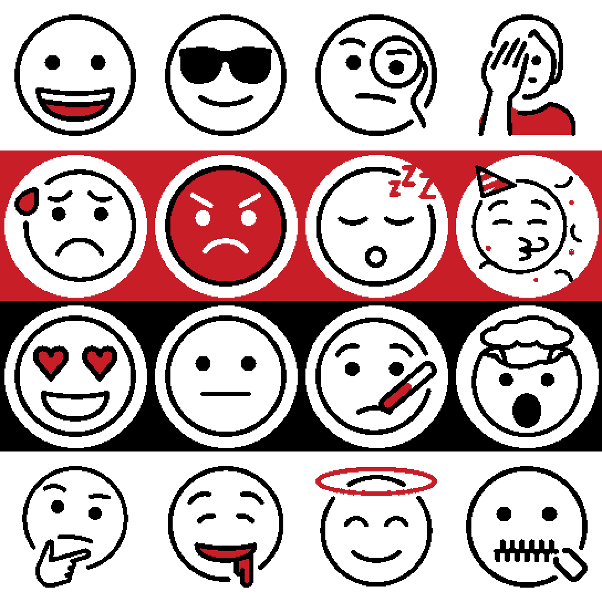

# Door Sign

An office door status sign: an ESP32 driving a 7.5" red/black/white e-paper panel that follows Google Calendar automatically and can be overridden from a phone or a one-tap bookmark.

- **Calendar driven.** A small Google Apps Script "broker" reads your calendars and returns a state, times, busy blocks and the current event's title. Events marked private show as plain BUSY with no title. Attendees and descriptions never leave Google.
- **Manual overrides.** The sign hosts its own control page (`http://door.local`) with status buttons, durations, custom messages and bookmarkable one-tap URLs like `/s/call?d=30&k=PIN`.
- **E-paper aware.** A tri-color refresh takes about 26 seconds, so the sign only redraws when the rendered frame actually changes.
- **Some personality.** A rotating library of one-liners per status, with humor levels.

Full design and milestones: [SPEC.md](SPEC.md).

## Hardware

- Waveshare E-Paper ESP32 Driver Board (ESP32, no PSRAM)
- Waveshare 7.5" e-Paper (B) V2, 800 x 480, red/black/white (GxEPD2 `GxEPD2_750c_Z08`)
- USB-C power

The driver board wires SPI to non-default pins (MOSI 14, SCLK 13, CS 15, DC 27, RST 26, BUSY 25); the firmware remaps them.

## Layout

```
firmware/   PlatformIO project (Arduino-ESP32)
  lib/core/   pure C++ status logic, unit-tested on the host
  src/        display, web server, broker client, storage
  test/       native unit tests
broker/     Google Apps Script status broker + Node tests
tools/      helper scripts
```

## Build and flash

Requires [PlatformIO](https://platformio.org/).

1. Copy `firmware/src/secrets.example.h` to `firmware/src/secrets.h` and set your Wi-Fi network.
2. Build and flash (board switch 2 ON):
   ```
   pio run -d firmware -t upload
   ```
3. The boot screen shows the sign's IP address. Open it in a browser. The default PIN is `1234`; change it on the Settings page.

After the first USB flash, updates can go over Wi-Fi:

- **From the dashboard:** System tab, "Firmware update". Pick `firmware/.pio/build/esp32dev/firmware.bin` and press Install.
- **From PlatformIO:** set `DOOR_PIN` to the sign's PIN, then
  ```
  pio run -d firmware -e ota -t upload --upload-port <sign IP>
  ```

The new firmware goes into the spare flash slot and the sign only switches to it after a complete write, so a failed upload leaves the old version running. Wi-Fi credentials still come from `secrets.h` at build time, so build with the network the sign is on.

Host unit tests (needs a host C++ compiler, for example MinGW-w64 on Windows):

```
pio test -d firmware -e native
```

## Calendar broker

Requires Node and [clasp](https://github.com/google/clasp).

```
cd broker
npm test                      # rule tests
clasp login
clasp create --type standalone --title "Door Sign Broker" --rootDir .
git checkout appsscript.json  # clasp create overwrites the manifest
clasp push && clasp deploy
```

Then in the Apps Script editor run `doorSetup` once. It asks for read-only calendar access and logs a token. On the sign's Settings page, enter the web app URL (ends in `/exec`) and the token, then pick calendars.

## Mood emoji

The sign can show a mood face at the end of the status band, set from the control page or `/m/<mood>?k=PIN` bookmarks; it clears itself each morning. The 16 faces are reduced to the panel's three colors by `tools/gen_moods.py`:



Emoji art: [OpenMoji](https://openmoji.org), the open-source emoji and icon project, by HfG Schwaebisch Gmuend. License: [CC BY-SA 4.0](https://creativecommons.org/licenses/by-sa/4.0/). The converted bitmaps in `firmware/src/display/mood_bitmaps.h` are shared under the same license.

## Time preview

The Status tab has a "Preview a time" card: pick a date and time and the sign (and the live preview image) shows what it would look like then, using your calendar for that moment. A red PREVIEW tag shows in the footer. Overrides and the mood are judged at that time but nothing is saved, and the sign goes back to the real time after 30 min or when you press "Back to the real time".

## Status

M1 (bench bring-up), M2 (manual sign) and M3 (calendar) are done. Wi-Fi firmware updates from M4 are in; the rest of M4 (typography, quip editor, daily clean refresh) is next.
